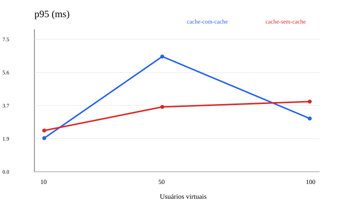
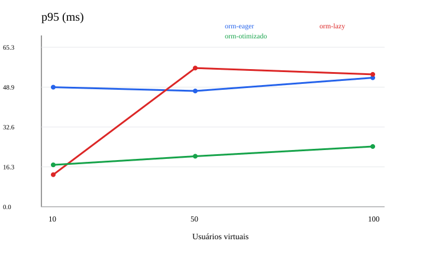
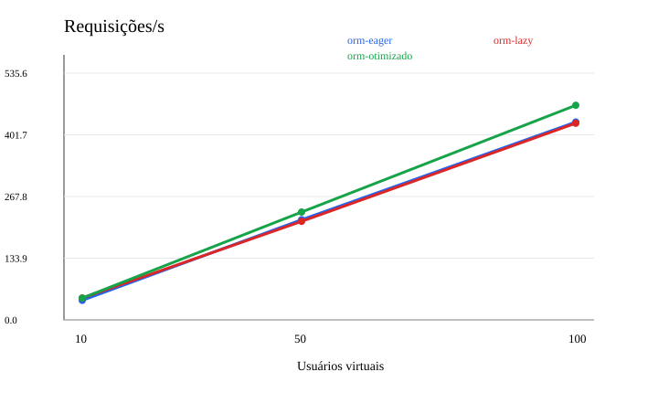
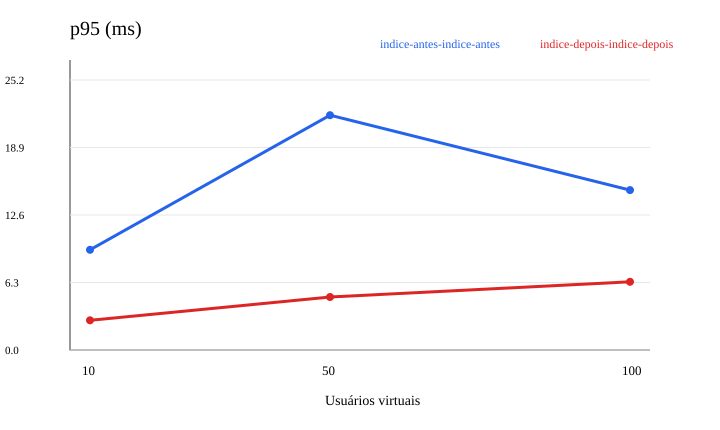

# Análise e Otimização de Sistemas — API de pedidos e experimentos - Trabalho Prático (A2)

## Tema: Otimização de Web Services por meio de Cache, Consultas ao Banco de Dados e Testes de Desempenho

## Professor: André Lúcio

## Integrantes: Gabriel Balduino (1230205586), Carlos Rocha (1240101330) e Everton Miguel (1230116950)

### 1. Introdução

Este repositório tem uma API (sem frontend) feita para testar três coisas na prática: cache de cliente, estratégias de carregamento de pedidos com itens no ORM e criação de índice para consulta por cliente. O banco populado para os testes tem **1.000 clientes, 100.000 pedidos e 300.000 itens** (conferidos com `SELECT count(*)` em cada tabela).

**Ambiente dos testes:** PostgreSQL 18.6, Java 21.0.13, Spring Boot 3.5.16 e k6 2.4.0, tudo rodando localmente na mesma máquina. Como o Docker não estava acessível na hora das medições, subimos o PostgreSQL localmente em espaço de usuário. Depois, o PostgreSQL 17 do `compose.yaml` também foi testado e [validado](resultados/docker-verificacao.txt) com o mesmo volume de dados, e os três JSONs de pedidos bateram igual. Os números de carga deste documento continuam sendo os do PostgreSQL 18.6. Os detalhes de versão e hardware estão em [ambiente.txt](resultados/ambiente.txt). As chamadas isoladas servem só para diagnóstico; a comparação de desempenho de verdade vem das rodadas do k6.

### 2. Arquitetura e tecnologias

O projeto usa Java 21, Spring Boot 3.5.16 (versão estável escolhida na [documentação oficial](https://docs.spring.io/spring-boot/)), Spring Web, Spring Data JPA/Hibernate, PostgreSQL, Caffeine e k6. O `compose.yaml` sobe um PostgreSQL 17 para quem quiser reproduzir, e o `sql/01-schema-seed.sql` cria as tabelas e popula o banco. O Hibernate está configurado só para validar o schema (`ddl-auto=validate`). A tabela `pedido` foi mapeada de duas formas (`PedidoLazy` e `PedidoEager`) justamente para comparar o comportamento sem mexer nos dados.

Para rodar, você vai precisar de Java 21, Maven, Docker com Compose, `curl` e [k6](https://grafana.com/docs/k6/latest/set-up/install-k6/).

```bash
docker compose up -d
docker compose exec db psql -U trabalho -d trabalho -c \
  'SELECT (SELECT count(*) FROM cliente) clientes, (SELECT count(*) FROM pedido) pedidos, (SELECT count(*) FROM item_pedido) itens;'
./mvnw spring-boot:run
```

Vale lembrar que o script SQL inicial só roda na criação do volume. Se precisar zerar tudo, `docker compose down -v` apaga os dados do banco local. Na hora de rodar os testes de carga, é importante subir a API com o perfil `carga` (`./mvnw spring-boot:run -Dspring-boot.run.profiles=carga`), que desliga o log de SQL e as estatísticas do Hibernate. Sempre rode todas as variantes no mesmo perfil e na mesma máquina para a comparação fazer sentido.

| Endpoint | O que faz |
|---|---|
| `GET /api/clientes/42/sem-cache` | Busca direto no banco |
| `GET /api/clientes/42/com-cache` | Busca usando Caffeine |
| `PUT /api/clientes/42` | Atualiza `{"nome":"Novo nome"}` e invalida o cache |
| `GET /api/pedidos/lazy?inicio=1&quantidade=50` | Carrega itens sob demanda |
| `GET /api/pedidos/eager?inicio=1&quantidade=50` | Carrega itens de forma antecipada |
| `GET /api/pedidos/otimizado?inicio=1&quantidade=50` | Carrega itens com `JOIN FETCH` |
| `GET /api/pedidos/cliente/42` | Traz os últimos 20 pedidos do cliente |

O parâmetro `quantidade` aceita 10, 50 ou 100, e `inicio` vai de 1 até 100.000. Todos os endpoints de ORM devolvem `id`, `status`, `quantidadeDeItens` e `valorTotal` (soma de `quantidade × preco` de cada item).

### 3. Cache

O cache `clientes` guarda até 2.000 entradas com TTL de **60 segundos após a escrita**. Nos testes, a segunda leitura do mesmo cliente deu hit sem bater no banco. Quando fizemos um `PUT` no mesmo ID, a entrada foi invalidada e a leitura seguinte foi no banco buscar `Cliente atualizado`. Esperando 61 segundos sem mexer no registro, o cache expirou e rolou um novo `SELECT` (os logs disso estão em [cache-demonstracao.json](resultados/cache-demonstracao.json)). Como o Caffeine fica na memória da aplicação, esse TTL ajuda a limitar por quanto tempo um dado antigo fica visível se alguém alterar o banco por fora, mas não resolve sincronização entre várias instâncias da API.

```java
@Cacheable(cacheNames = "clientes", key = "#id")
public ClienteDto comCache(Long id) { return buscar(id); }

@Transactional
@CacheEvict(cacheNames = "clientes", key = "#id")
public ClienteDto atualizar(Long id, String nome) {
    Cliente cliente = encontrar(id);
    cliente.setNome(nome);
    return new ClienteDto(cliente.getId(), cliente.getNome());
}
```

Escolhemos 60 segundos porque nome de cliente muda pouco nesse cenário. Pela API, o `PUT` já limpa o cache na hora; por fora, o valor antigo dura no máximo esse tempo. Se fosse um dado que muda toda hora, teria que baixar o TTL ou usar um cache distribuído.

| Etapa | SELECTs de cliente | Tempo HTTP isolado (ms) |
|---|---:|---:|
| Miss | 1 | 102,243 |
| Hit | 0 | 11,609 |
| Sem cache | 1 | 19,492 |
| Após PUT | 1 | 15,464 |
| Hit antes do TTL | 0 | 12,171 |
| Após expirar o TTL | 1 | 120,288 |

Esses números de chamada única não servem para provar ganho de performance (tem aquecimento da JVM e ruído de uma requisição só). O `PUT` gerou um `SELECT` e um `UPDATE`.

Para testar isso na mão com o perfil padrão (log SQL ligado), basta rodar uma chamada por vez e ir olhando o console:

```bash
curl -w ' tempo=%{time_total}s\n' http://localhost:8080/api/clientes/42/com-cache
curl -w ' tempo=%{time_total}s\n' http://localhost:8080/api/clientes/42/com-cache
curl -w ' tempo=%{time_total}s\n' http://localhost:8080/api/clientes/42/sem-cache
curl -X PUT -H 'Content-Type: application/json' -d '{"nome":"Cliente atualizado"}' http://localhost:8080/api/clientes/42
curl -w ' tempo=%{time_total}s\n' http://localhost:8080/api/clientes/42/com-cache
```

Para ver o TTL expirando, chame um ID novo duas vezes, espere mais de 60 segundos sem dar `PUT` e chame de novo. No script `carga/medir.sh`, a carga `com-cache` aquece o ID 42 e mede **hit**; já uma chamada isolada no ID 43 com cache vazio mede **miss**.

### 4. Otimização de consultas

Os modos `lazy`, `eager` e `otimizado` foram testados com janelas de 10, 50 e 100 pedidos. O serviço percorre os itens **dentro da transação** para montar o mesmo DTO, e comparamos os JSONs nas três janelas para garantir que a saída é idêntica. Nessa versão do Hibernate, tanto LAZY quanto EAGER dispararam 1 `SELECT` para os pedidos + 1 `SELECT` para cada pedido (problema N+1), enquanto o `JOIN FETCH` resolveu tudo em 1 `SELECT` só. Os tempos abaixo são de chamadas isoladas; os detalhes estão em [orm-consultas.csv](resultados/orm-consultas.csv) e [sql-representativo.txt](resultados/sql-representativo.txt).

| Pedidos | LAZY: SELECTs / ms | EAGER: SELECTs / ms | JOIN FETCH: SELECTs / ms | Itens | JSON (bytes) |
|---:|---:|---:|---:|---:|---:|
| 10 | 11 / 27,566 | 11 / 23,289 | 1 / 13,305 | 30 | 682 |
| 50 | 51 / 63,690 | 51 / 53,815 | 1 / 11,641 | 150 | 3.442 |
| 100 | 101 / 121,680 | 101 / 44,101 | 1 / 9,724 | 300 | 6.893 |

No `JOIN FETCH`, as colunas do pedido vêm repetidas nas linhas do SQL, mas o JSON final tem exatamente o mesmo tamanho. O LAZY só economizaria consultas se os itens não fossem acessados, o que não é o caso aqui. O EAGER até carrega antes, mas acabou fazendo consultas separadas do mesmo jeito. Não precisamos recorrer a SQL nativo para resolver isso.

```java
@Query("select distinct p from PedidoLazy p left join fetch p.itens "
     + "where p.id between :inicio and :fim order by p.id")
List<PedidoLazy> buscarComItens(Long inicio, Long fim);
```

```bash
for quantidade in 10 50 100; do
  for variante in lazy eager otimizado; do
    curl -sS -w " variante=$variante quantidade=$quantidade tempo=%{time_total}s bytes=%{size_download}\n" \
      -o "resultados/${variante}-${quantidade}.json" \
      "http://localhost:8080/api/pedidos/${variante}?inicio=1&quantidade=${quantidade}"
  done
  cmp "resultados/lazy-${quantidade}.json" "resultados/eager-${quantidade}.json"
  cmp "resultados/lazy-${quantidade}.json" "resultados/otimizado-${quantidade}.json"
done
```

Na parte de indexação, o [plano sem índice](resultados/plano-antes.txt) fez um `Seq Scan` nos 100.000 pedidos, descartou 99.900 linhas, ordenou os 100 pedidos do cliente e devolveu 20, levando **4,690 ms** com **739 buffers hit**. Depois de rodar `CREATE INDEX idx_pedido_cliente_data ON pedido(cliente_id, criado_em DESC)` e `ANALYZE pedido`, o [plano com índice](resultados/plano-depois.txt) mudou para `Index Scan`, já entregou as 20 linhas ordenadas sem `Sort` explícito e caiu para **0,151 ms** (**23 buffers hit** e **3 read**). Esses tempos são internos do Postgres, não da API. O índice ocupou [3.104 kB](resultados/indice-tamanho.txt). A chave primária sozinha não resolve esse filtro com ordenação, mas também não faz sentido sair indexando toda coluna, já que cada índice ocupa espaço e deixa `INSERT`, `UPDATE` e `DELETE` mais pesados.

### 5. Testes de desempenho

Usamos o k6 porque facilita fixar usuários virtuais (VUs), tempo de duração, checks HTTP e salvar tudo em JSON. O script `carga/medir.sh` faz um aquecimento antes de valer (uma chamada simples e uma rodada curta descartada). Cada cenário rodou **3 vezes por 15 segundos**, testando 10, 50 e 100 VUs por variante, com pausa de 0,2s entre chamadas de cada VU. Optamos por 15 segundos para conseguir fechar todas as 63 rodadas em tempo hábil na máquina local (testes mais longos ajudariam a ver estabilidade em regime contínuo). Para reproduzir exatamente como medimos:

```bash
DURACAO=15s bash carga/medir.sh cache
DURACAO=15s bash carga/medir.sh orm
DB_MODE=local bash carga/planos.sh antes
DURACAO=15s bash carga/medir.sh indice-antes
DB_MODE=local bash carga/planos.sh depois
DURACAO=15s bash carga/medir.sh indice-depois
python3 carga/resumir.py
```

Se for usar o banco do `compose.yaml`, basta tirar o `DB_MODE=local`. Por padrão o `medir.sh` usa 60s, então `DURACAO=15s` força o protocolo deste relatório. O índice foi criado só entre as rodadas `antes` e `depois`. Vale registrar que a primeira tentativa sem índice foi descartada porque a API caiu com código 137 na última rodada (os logs ficaram em [descartadas](resultados/descartadas/) e não entraram nas contas). Repetimos a série inteira sem índice e rodamos as duas séries de índice na mesma instância da API (JAR com `-Xmx512m`).

O arquivo [resumo.csv](resultados/resumo.csv) traz a **mediana das três rodadas** e [faixas.csv](resultados/faixas.csv) mostra mínimo e máximo. Todas as 63 rodadas válidas tiveram **0% de erro HTTP**. Lembrando que VUs não são req/s: o `sleep(0.2)` limita a taxa máxima, principalmente nos endpoints que respondem muito rápido.

| Experimento | Variante | VUs | Média (ms) | p95 (ms) | p99 (ms) | req/s | Erros (%) |
|---|---|---:|---:|---:|---:|---:|---:|
| Cache | sem cache | 10 | 1.735 | 2.322 | 4.526 | 49.376 | 0 |
| Cache | hit | 10 | 1.155 | 1.893 | 2.381 | 49.533 | 0 |
| Cache | sem cache | 50 | 2.041 | 3.651 | 11.496 | 245.503 | 0 |
| Cache | hit | 50 | 2.904 | 6.488 | 11.427 | 244.628 | 0 |
| Cache | sem cache | 100 | 2.146 | 3.951 | 8.826 | 489.389 | 0 |
| Cache | hit | 100 | 1.451 | 2.997 | 6.309 | 494.182 | 0 |
| ORM | LAZY | 10 | 10.195 | 13.114 | 14.654 | 47.408 | 0 |
| ORM | EAGER | 10 | 33.285 | 48.915 | 70.318 | 42.395 | 0 |
| ORM | JOIN FETCH | 10 | 9.352 | 17.140 | 22.625 | 47.380 | 0 |
| ORM | LAZY | 50 | 30.380 | 56.751 | 85.512 | 213.815 | 0 |
| ORM | EAGER | 50 | 26.933 | 47.388 | 77.686 | 217.349 | 0 |
| ORM | JOIN FETCH | 50 | 11.006 | 20.669 | 31.767 | 234.007 | 0 |
| ORM | LAZY | 100 | 31.037 | 54.164 | 120.283 | 426.843 | 0 |
| ORM | EAGER | 100 | 29.760 | 52.803 | 105.908 | 429.488 | 0 |
| ORM | JOIN FETCH | 100 | 11.625 | 24.658 | 50.871 | 465.748 | 0 |
| Índice | antes | 10 | 6.841 | 9.363 | 10.815 | 48.090 | 0 |
| Índice | depois | 10 | 1.411 | 2.780 | 4.238 | 49.472 | 0 |
| Índice | antes | 50 | 12.526 | 21.944 | 47.638 | 232.508 | 0 |
| Índice | depois | 50 | 2.412 | 4.949 | 11.171 | 245.157 | 0 |
| Índice | antes | 100 | 10.617 | 14.949 | 50.622 | 469.529 | 0 |
| Índice | depois | 100 | 2.315 | 6.375 | 15.944 | 487.635 | 0 |








Lembrando que o tempo do `EXPLAIN ANALYZE` mede só o banco, enquanto a API inclui conexão, mapeamento, serialização JSON e HTTP.

### 6. Discussão

O cache zerou os `SELECT`s nos hits, mas **nem sempre baixou a latência**. Com 10 e 100 VUs, a média caiu cerca de 33% e 32%; já com 50 VUs, subiu de 2,041 para 2,904 ms (e o p95 foi de 3,651 para 6,488 ms). Como as três rodadas de hit em 50 VUs tiveram p95 entre 6,241 e 7,483 ms, não foi um ponto fora da curva isolado. Como a leitura direta no banco já era muito rápida, o overhead da aplicação, oscilações da máquina e eventuais expirações de TTL acabam pesando mais. Em req/s a diferença também foi pequena por causa do `sleep(0.2)`, que trava cada VU perto de 5 req/s.

No ORM, LAZY e EAGER sofreram com N+1 e tiveram comportamento parecido sob carga. O `JOIN FETCH` cortou de 51 para 1 consulta na janela de 50 pedidos. Com 50 e 100 VUs, a média caiu **63,8% e 62,5%** em relação ao LAZY, o p95 caiu **63,6% e 54,5%** e o p99 caiu **62,9% e 57,7%**. Curiosamente, com 10 VUs a média caiu 8,3%, mas p95 e p99 subiram (30,7% e 54,4%), mostrando que reduzir SQL não garante cauda menor em carga baixa.

O índice foi onde vimos o maior ganho relativo nesse endpoint: a média HTTP caiu **79,4%, 80,7% e 78,2%** para 10, 50 e 100 VUs, o p95 caiu **70,3%, 77,4% e 57,4%** e o p99 caiu **60,8%, 76,6% e 68,5%**. Mesmo assim, na série sem índice em 100 VUs o p95 oscilou bastante entre as rodadas (de 14,169 a 92,563 ms). O cache de páginas do próprio PostgreSQL e o custo fixo de rede/serialização explicam por que a melhora no HTTP não acompanha na mesma proporção a queda absurda do `EXPLAIN ANALYZE`.

Também fizemos uma amostragem pontual de CPU/memória durante a carga ORM ([recursos-amostra.txt](resultados/recursos-amostra.txt)), mas sem série contínua não dá para cravar gargalo de hardware. Além disso, rodadas de 15s em ordem fixa deixam em aberto como a aplicação se comportaria em testes mais longos.

### 7. Conclusão

No fim, as otimizações funcionam quando cortam trabalho pesado de verdade, e isso aparece tanto no SQL quanto nas medições repetidas. O `JOIN FETCH` resolveu o N+1 e brilhou com 50 e 100 VUs; o índice tirou o `Seq Scan` + `Sort` da consulta por cliente e trouxe o maior ganho do experimento; e o cache funcionou bem para hits, invalidação e TTL, embora em consultas já muito rápidas o ganho de latência varie bastante conforme a carga.
