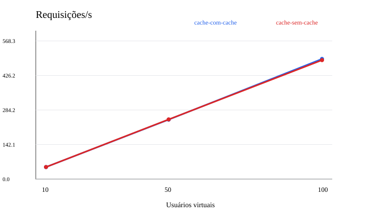
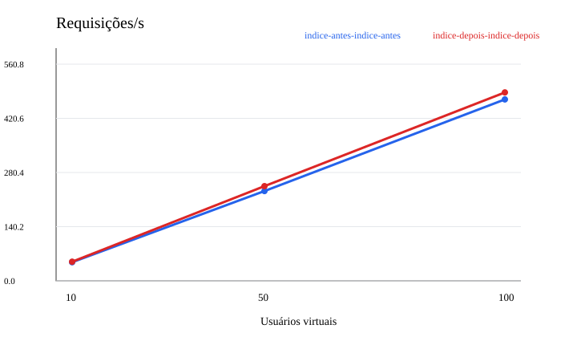

# OtimizaSistema — API de pedidos e experimentos

## 1. Introdução

Este repositório reúne uma API sem frontend e três experimentos: cache de cliente, carregamento de pedidos com itens e índice para consulta por cliente. O banco medido contém **1.000 clientes, 100.000 pedidos e 300.000 itens**, confirmados por `SELECT count(*)` em cada tabela.

**Ambiente medido:** PostgreSQL 18.6, Java 21.0.13, Spring Boot 3.5.16 e k6 2.4.0, executados localmente no mesmo computador. O PostgreSQL foi iniciado em espaço do usuário porque o Docker não estava acessível. As versões, contagens e capacidade da máquina constam em [ambiente.txt](resultados/ambiente.txt). Os tempos de chamada isolada são apenas diagnósticos; a comparação de desempenho usa as rodadas k6.

## 2. Arquitetura e tecnologias

Java 21, Spring Boot 3.5.16, Spring Web, Spring Data JPA/Hibernate, PostgreSQL, Caffeine e k6. `compose.yaml` fornece PostgreSQL 17 para reprodução; as medidas deste relatório usaram PostgreSQL 18.6 local. `sql/01-schema-seed.sql` cria as tabelas e insere os dados. O Hibernate apenas valida o esquema (`ddl-auto=validate`). A aplicação mapeia `pedido` de duas formas de leitura, `PedidoLazy` e `PedidoEager`, para comparar o carregamento sem alterar os dados.

Para iniciar, instale Java 21, Maven, Docker com Compose, curl e [k6](https://grafana.com/docs/k6/latest/set-up/install-k6/). A versão do Spring Boot foi escolhida entre as [versões estáveis publicadas](https://docs.spring.io/spring-boot/).

```bash
docker compose up -d
docker compose exec db psql -U trabalho -d trabalho -c \
  'SELECT (SELECT count(*) FROM cliente) clientes, (SELECT count(*) FROM pedido) pedidos, (SELECT count(*) FROM item_pedido) itens;'
./mvnw spring-boot:run
```

O SQL de inicialização só roda quando o volume é criado. `docker compose down -v` remove **todos os dados desse banco local**. Para carga, reinicie a API com `./mvnw spring-boot:run -Dspring-boot.run.profiles=carga`; esse perfil desliga o log SQL detalhado e as estatísticas Hibernate. Use o mesmo perfil e a mesma máquina em todas as variantes de cada comparação.

| Endpoint | Finalidade |
|---|---|
| `GET /api/clientes/42/sem-cache` | Leitura direta do banco |
| `GET /api/clientes/42/com-cache` | Leitura com Caffeine |
| `PUT /api/clientes/42` | Atualiza `{"nome":"Novo nome"}` e invalida cache |
| `GET /api/pedidos/lazy?inicio=1&quantidade=50` | Itens sob demanda |
| `GET /api/pedidos/eager?inicio=1&quantidade=50` | Itens antecipados |
| `GET /api/pedidos/otimizado?inicio=1&quantidade=50` | Itens por JOIN FETCH |
| `GET /api/pedidos/cliente/42` | Últimos 20 pedidos do cliente |

`quantidade` aceita 10, 50 ou 100. `inicio` deve caber em 1..100.000. Todos os modos ORM retornam `id`, `status`, `quantidadeDeItens` e `valorTotal`; o valor total soma `quantidade × preco` de cada item.

## 3. Cache

O cache `clientes` tem capacidade de 2.000 entradas e TTL de **60 segundos após a escrita**. Uma leitura repetida de cliente produziu um hit sem novo SELECT. O `PUT` invalidou a entrada pelo mesmo ID; a próxima leitura consultou o banco e retornou `Cliente atualizado`. Depois de esperar 61 segundos sem outra escrita, ocorreu novo SELECT. Evidência detalhada: [cache-demonstracao.json](resultados/cache-demonstracao.json). O TTL limita a duração de um valor antigo quando o cliente muda fora desta API, mas Caffeine é local ao processo: alterações diretas no banco e outras instâncias não propagam a invalidação.

```java
@Cacheable(cacheNames = "clientes", key = "#id")
public ClienteDto comCache(Long id) { return buscar(id); }

@Transactional
@CacheEvict(cacheNames = "clientes", key = "#id")
public ClienteDto atualizar(Long id, String nome) {
    Cliente cliente = encontrar(id);
    cliente.setNome(nome);
    return new ClienteDto(cliente.getId(), cliente.getNome());
}
```

O TTL de 60 segundos foi escolhido para um nome de cliente, dado pouco volátil neste laboratório. A atualização pela API invalida imediatamente; uma alteração externa pode deixar o nome antigo visível por até cerca de 60 segundos. Para dados mais voláteis, seria preciso um TTL menor ou invalidação entre instâncias.

| Etapa | SELECTs de cliente | Tempo HTTP isolado (ms) |
|---|---:|---:|
| Miss | 1 | 102,243 |
| Hit | 0 | 11,609 |
| Sem cache | 1 | 19,492 |
| Após PUT | 1 | 15,464 |
| Hit antes do TTL | 0 | 12,171 |
| Após expirar o TTL | 1 | 120,288 |

Esses tempos não provam ganho sustentado: incluem aquecimento e variação de uma única requisição. O `PUT` emitiu SELECT e UPDATE.

Com o perfil padrão e log SQL habilitado, execute uma chamada por vez e anote o SELECT e o tempo HTTP:

```bash
curl -w ' tempo=%{time_total}s\n' http://localhost:8080/api/clientes/42/com-cache
curl -w ' tempo=%{time_total}s\n' http://localhost:8080/api/clientes/42/com-cache
curl -w ' tempo=%{time_total}s\n' http://localhost:8080/api/clientes/42/sem-cache
curl -X PUT -H 'Content-Type: application/json' -d '{"nome":"Cliente atualizado"}' http://localhost:8080/api/clientes/42
curl -w ' tempo=%{time_total}s\n' http://localhost:8080/api/clientes/42/com-cache
```

Para o TTL, consulte um ID ainda não usado duas vezes, espere mais de 60 segundos sem `PUT` e consulte novamente. Registre a nova consulta SQL. A carga `com-cache` de `carga/medir.sh` aquece o ID 42 e mede **hit**; uma chamada única a ID 43 com cache vazio é um **miss**. Uma carga repetida ao mesmo ID não mede misses.

## 4. Otimização de consultas

`lazy`, `eager` e `otimizado` foram chamados com as mesmas janelas de 10, 50 e 100 IDs. O serviço percorre os itens **dentro da transação** para construir o mesmo DTO. Os JSONs foram comparados e são iguais nas três janelas. Nesta versão do Hibernate, LAZY e EAGER emitiram uma consulta de pedidos mais uma por pedido; JOIN FETCH emitiu uma consulta por chamada. Os tempos abaixo são de chamadas isoladas, sem repetição controlada. [orm-consultas.csv](resultados/orm-consultas.csv) e [sql-representativo.txt](resultados/sql-representativo.txt) guardam as evidências.

| Pedidos | LAZY: SELECTs / ms | EAGER: SELECTs / ms | JOIN FETCH: SELECTs / ms | Itens | JSON (bytes) |
|---:|---:|---:|---:|---:|---:|
| 10 | 11 / 27,566 | 11 / 23,289 | 1 / 13,305 | 30 | 682 |
| 50 | 51 / 63,690 | 51 / 53,815 | 1 / 11,641 | 150 | 3.442 |
| 100 | 101 / 121,680 | 101 / 44,101 | 1 / 9,724 | 300 | 6.893 |

O JOIN FETCH repete as colunas do pedido nas linhas SQL, mas o JSON público teve o mesmo tamanho nas três variantes. LAZY evita ler itens quando não são necessários; neste endpoint todos são percorridos, gerando N+1. EAGER leu os itens antecipadamente, porém também em consultas secundárias. SQL nativo não foi necessário; adicioná-lo aumentaria a dependência do dialeto sem benefício medido.

```java
@Query("select distinct p from PedidoLazy p left join fetch p.itens "
     + "where p.id between :inicio and :fim order by p.id")
List<PedidoLazy> buscarComItens(Long inicio, Long fim);
```

```bash
for quantidade in 10 50 100; do
  for variante in lazy eager otimizado; do
    curl -sS -w " variante=$variante quantidade=$quantidade tempo=%{time_total}s bytes=%{size_download}\n" \
      -o "resultados/${variante}-${quantidade}.json" \
      "http://localhost:8080/api/pedidos/${variante}?inicio=1&quantidade=${quantidade}"
  done
  cmp "resultados/lazy-${quantidade}.json" "resultados/eager-${quantidade}.json"
  cmp "resultados/lazy-${quantidade}.json" "resultados/otimizado-${quantidade}.json"
done
```

O [plano sem índice](resultados/plano-antes.txt) fez `Seq Scan` sobre 100.000 pedidos, descartou 99.900 linhas, ordenou os 100 pedidos do cliente e retornou 20; registrou **4,690 ms** e **739 buffers hit**. Depois de executar `CREATE INDEX idx_pedido_cliente_data ON pedido(cliente_id, criado_em DESC)` e `ANALYZE pedido`, o [plano com índice](resultados/plano-depois.txt) fez `Index Scan`, retornou 20 linhas sem `Sort` explícito e registrou **0,151 ms**, **23 buffers hit** e **3 read**. São tempos internos do banco para uma execução de cada plano, não medianas HTTP. O índice foi de fato utilizado e ocupou [3.104 kB](resultados/indice-tamanho.txt) neste banco. A chave primária não atende automaticamente a esse filtro e ordem. Índices ocupam espaço e adicionam trabalho a INSERT, UPDATE e DELETE; criar um para toda coluna consultada aumentaria esse custo sem garantia de uso pelo planejador.

## 5. Testes de desempenho

Use um ambiente local ou de laboratório autorizado. k6 foi escolhido porque permite fixar usuários virtuais, duração, verificações HTTP e exportar métricas por rodada em JSON. `carga/medir.sh` aquece cada endpoint com uma chamada e uma rodada curta descartada. A medição usou **3 rodadas de 15 segundos** para 10, 50 e 100 usuários virtuais por variante, uma rodada por vez. A duração de 15 segundos foi adotada para completar as 63 rodadas neste computador; testes mais longos seriam úteis para avaliar estabilidade prolongada. Cada usuário espera 0,2 segundo entre chamadas. Para reproduzir exatamente a duração medida:

```bash
DURACAO=15s bash carga/medir.sh cache
DURACAO=15s bash carga/medir.sh orm
DB_MODE=local bash carga/planos.sh antes
DURACAO=15s bash carga/medir.sh indice-antes
DB_MODE=local bash carga/planos.sh depois
DURACAO=15s bash carga/medir.sh indice-depois
python3 carga/resumir.py
```

Para o banco do `compose.yaml`, omita `DB_MODE=local`. `carga/medir.sh` usa 60 segundos por padrão; `DURACAO=15s` seleciona o protocolo medido aqui. O índice foi criado **somente entre** as séries antes e depois. A primeira tentativa da série sem índice foi descartada porque a API terminou com código 137 na última rodada; os arquivos originais estão em [descartadas](resultados/descartadas/) e não entram nas medianas. A série sem índice foi repetida integralmente e ambas as séries de índice usaram a mesma instância da API, iniciada como JAR com heap máximo de 512 MB. Não houve evidência suficiente para atribuir o encerramento a uma causa específica.

[resumo.csv](resultados/resumo.csv) contém a **mediana das três rodadas** para cada métrica. [faixas.csv](resultados/faixas.csv) contém mínimo e máximo; os JSONs individuais preservam todas as saídas do k6. Todas as 63 rodadas válidas tiveram **0% de erros HTTP**. VUs não são req/s; a pausa de 0,2 segundo limita a taxa alcançável, principalmente nos endpoints rápidos.

| Experimento | Variante | VUs | Média (ms) | p95 (ms) | p99 (ms) | req/s | Erros (%) |
|---|---|---:|---:|---:|---:|---:|---:|
| Cache | sem cache | 10 | 1.735 | 2.322 | 4.526 | 49.376 | 0 |
| Cache | hit | 10 | 1.155 | 1.893 | 2.381 | 49.533 | 0 |
| Cache | sem cache | 50 | 2.041 | 3.651 | 11.496 | 245.503 | 0 |
| Cache | hit | 50 | 2.904 | 6.488 | 11.427 | 244.628 | 0 |
| Cache | sem cache | 100 | 2.146 | 3.951 | 8.826 | 489.389 | 0 |
| Cache | hit | 100 | 1.451 | 2.997 | 6.309 | 494.182 | 0 |
| ORM | LAZY | 10 | 10.195 | 13.114 | 14.654 | 47.408 | 0 |
| ORM | EAGER | 10 | 33.285 | 48.915 | 70.318 | 42.395 | 0 |
| ORM | JOIN FETCH | 10 | 9.352 | 17.140 | 22.625 | 47.380 | 0 |
| ORM | LAZY | 50 | 30.380 | 56.751 | 85.512 | 213.815 | 0 |
| ORM | EAGER | 50 | 26.933 | 47.388 | 77.686 | 217.349 | 0 |
| ORM | JOIN FETCH | 50 | 11.006 | 20.669 | 31.767 | 234.007 | 0 |
| ORM | LAZY | 100 | 31.037 | 54.164 | 120.283 | 426.843 | 0 |
| ORM | EAGER | 100 | 29.760 | 52.803 | 105.908 | 429.488 | 0 |
| ORM | JOIN FETCH | 100 | 11.625 | 24.658 | 50.871 | 465.748 | 0 |
| Índice | antes | 10 | 6.841 | 9.363 | 10.815 | 48.090 | 0 |
| Índice | depois | 10 | 1.411 | 2.780 | 4.238 | 49.472 | 0 |
| Índice | antes | 50 | 12.526 | 21.944 | 47.638 | 232.508 | 0 |
| Índice | depois | 50 | 2.412 | 4.949 | 11.171 | 245.157 | 0 |
| Índice | antes | 100 | 10.617 | 14.949 | 50.622 | 469.529 | 0 |
| Índice | depois | 100 | 2.315 | 6.375 | 15.944 | 487.635 | 0 |







O tempo de `EXPLAIN ANALYZE` é apenas do banco; o tempo da API inclui conexão, mapeamento, serialização e HTTP.

## 6. Discussão

O cache eliminou SELECTs nos hits, mas **não melhorou sempre a latência**. Em 10 e 100 VUs, a média caiu aproximadamente 33% e 32%; em 50 VUs, subiu de 2,041 para 2,904 ms e o p95 subiu de 3,651 para 6,488 ms. As três rodadas de hit em 50 VUs tiveram p95 de 6,241 a 7,483 ms, então não se trata de uma única amostra extrema. O custo de uma leitura simples já era baixo; overhead da aplicação, variação temporal da máquina e expirações ocasionais do TTL podem ter reduzido o benefício. Esses dados não isolam qual fator causou a piora. O ganho em req/s foi pequeno porque `sleep(0.2)` aproxima a taxa do limite de 5 requisições por segundo por VU.

LAZY apresentou N+1 porque o DTO precisa percorrer todos os itens. EAGER também fez consultas secundárias, com a mesma contagem de SELECTs; o custo sob carga não foi uniformemente melhor nem pior. JOIN FETCH reduziu os SELECTs de 51 para 1 na janela de 50 pedidos. Em 50 e 100 VUs, a média caiu **63,8% e 62,5%** frente a LAZY, o p95 caiu **63,6% e 54,5%**, e o p99 caiu **62,9% e 57,7%**. Em 10 VUs, a média caiu 8,3%, mas p95 e p99 **pioraram** 30,7% e 54,4%; o menor número de SQL não garante cauda menor em toda carga. O tamanho do JSON foi igual nas três variantes; a duplicação das colunas no JOIN ocorre no tráfego banco–API, não na resposta pública.

O índice foi usado pelo PostgreSQL e reduziu o trabalho de varredura e ordenação. No HTTP, a média caiu **79,4%, 80,7% e 78,2%** em 10, 50 e 100 VUs. O p95 caiu **70,3%, 77,4% e 57,4%** e o p99 caiu **60,8%, 76,6% e 68,5%**. Entre as três técnicas medidas, esse foi o maior ganho relativo de média **para o endpoint escolhido**; são cargas e consultas diferentes, então o percentual não estabelece uma regra geral. A série sem índice em 100 VUs teve p95 de **14,169 a 92,563 ms** nas três rodadas, sinal de variação relevante apesar da mediana de 14,949 ms. O cache de páginas do PostgreSQL e o custo fixo de conexão, serialização e HTTP ajudam a explicar por que os tempos da API não seguem exatamente os do `EXPLAIN ANALYZE`.

O consumo foi amostrado pontualmente durante a carga ORM em [recursos-amostra.txt](resultados/recursos-amostra.txt); não há série temporal suficiente para atribuir gargalo a CPU ou memória. As rodadas de 15 segundos e a ordem fixa das variantes limitam conclusões sobre estabilidade prolongada e efeitos de deriva do ambiente.

## 7. Conclusão

A mudança melhora o desempenho quando reduz trabalho efetivamente necessário e isso aparece tanto na execução quanto nas medidas repetidas. Aqui, JOIN FETCH eliminou N+1 e teve ganho claro em 50 e 100 VUs; o índice transformou a consulta do cliente de varredura e ordenação em busca ordenada e apresentou o maior ganho relativo de média desse endpoint. O cache demonstrou hits, invalidação e TTL, mas seu efeito de latência variou com a carga. Os planos, logs, saídas k6, tabelas e gráficos permitem conferir essas conclusões e seus limites.

**Roteiro de apresentação (até 7 min):** 0:00–0:40 arquitetura e volume; 0:40–1:50 cache, PUT, hit e TTL; 1:50–3:10 SQL LAZY/EAGER/JOIN FETCH; 3:10–4:10 planos antes/depois; 4:10–5:10 uma execução k6 curta; 5:10–6:40 gráficos, conclusão e limites. Use as evidências já gravadas em `resultados/`; na apresentação, execute apenas uma demonstração curta do k6.
